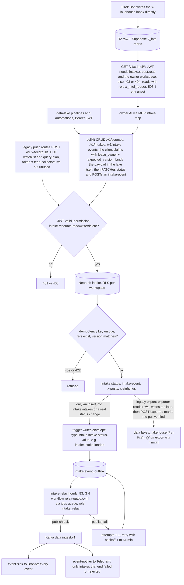

# 01 — Business process (As-Is / To-Be)

platform-intake-api คือ Intake cell: API บน Railway (cellkit + Neon) ที่เป็นประตูหน้าของ data lake เก็บทะเบียนแหล่งข้อมูล คิว intake พร้อม lease และ event trail ของทุกสถานะ รับ X feed จาก collector ของ Grok Bot, เปิดอ่านข้อมูล X marts ให้ AI ของ owner และส่ง event ของ intake ผ่าน outbox ไป Kafka `data.ingest.v1` ทุกชั่วโมง

Last reviewed: 2026-11-27 · commit `b7bcb57`

## As-Is (จากโค้ดวันนี้)

Sources: `src/solo_intake/x_feed.py`, `src/solo_intake/x_intel.py`, `src/solo_intake/event_outbox.py`, `cell.yaml`, `migrations/0001_intake.sql`, `migrations/0003_event_outbox.sql`, `.github/workflows/relay-outbox.yml`, `README.md`, `PRODUCT.md`, `docs/x-feed-ingest.md`

ข้อเท็จจริงสำคัญจากโค้ดและเอกสาร:

- CRUD ทั้งหมดมาจาก `platform-cellkit` (pinned 1.0.11) ตาม `cell.yaml`; repo นี้เป็นเจ้าของ `cell.yaml`, migrations และโมดูล `src/solo_intake/`
- relay เรียงลำดับตาม key: แถวที่ล้มเหลวจะส่งเฉพาะแถวนั้นก่อน และรอ backoff (`SELECT_UNSENT`, `MARK_FAILED`)
- ไม่บังคับ: `from_status`/`to_status` ของ event ตรงกับ intake จริง, `domain`/`dataset` ตรงกับ source (PRODUCT.md)
- เส้นทาง X ที่ใช้จริงคือ bot → inbox ของ x-lakehouse → R2/Supabase `x_intel` → `/v1/x-intel/*` (registry `online-systems.yaml`: push routes `/v1/x-feed/*` live แต่ไม่ได้ใช้); การ purge ข้อความของ x-feed เกิดตอน push ครั้งถัดไปหลัง retention ไม่ใช่ตอน mark exported
- ผู้เรียก export ของ X feed (เส้นทางเดิม) และ host ที่ตั้งเวลายังไม่ยืนยันจากโค้ด; spec 002 ระบุว่ายังไม่มี host (ความเสี่ยง #2) [ต้องยืนยัน]
- `platform-event-hub-api` เขียน intake ที่นี่หรือไม่: PRODUCT.md ระบุ [ต้องยืนยัน]

## To-Be (ไม่มีที่ระบุเป็นสถานะเป้าหมาย)

ไม่มี To-Be ที่เขียนไว้: `specs/001-l2-baseline`, `002-x-feed` และ `003-x-intel-read` บรรยายสิ่งที่ implement แล้ว สถานะยัง "in review / owner approval pending" (001, 002) และ "approved" (003) ส่วน `PRODUCT.md` §Measures เป็นตัวชี้วัดที่เสนอ (proposed) และยังไม่มีใครเก็บ

Sources: `specs/001-l2-baseline/spec.md`, `specs/002-x-feed/spec.md`, `specs/003-x-intel-read/spec.md`, `PRODUCT.md`

## Gap

| ID | As-Is → To-Be | Status | Owner | Evidence |
|---|---|---|---|---|
| G1 | spec 001 และ 002 สถานะ "owner approval pending" → owner อนุมัติ spec | decide | owner | `specs/001-l2-baseline/spec.md` §Approval; `specs/002-x-feed/spec.md` |
| G2 | ไม่มีใครเก็บ measures (intake ค้างเกิน lease, สัดส่วน failed/rejected, 5xx และ p95) → เก็บและดูได้ | todo | claude | `PRODUCT.md` §Measures (Proposed, nothing collects these yet) |
| G3 | (เส้นทาง x-feed เดิม ที่ไม่ได้ใช้แล้ว) lake export ไม่มี host ตั้งเวลา → ปลดระวางเส้นทางเดิม หรือตั้ง export ตามกำหนดให้ pull ไม่ค้างที่ `landed` | decide | owner | `specs/002-x-feed/spec.md` §7 ความเสี่ยง #2 |
| G4 | (เส้นทาง x-feed เดิม ที่ไม่ได้ใช้แล้ว) token `x-feed-collector` หมดอายุ 30 วัน และ rotate อัตโนมัติไม่ได้ → ปลดระวางหรือทำ rotate ที่ไม่พึ่งมือ | decide | owner | `specs/002-x-feed/spec.md` §7 ความเสี่ยง #1; `docs/x-feed-ingest.md` §Token |
| G5 | ไม่บังคับให้ event `from_status`/`to_status` และ `domain`/`dataset` ตรงกับ intake/source → บังคับหรือยอมรับ | decide | owner | `PRODUCT.md` §Capabilities (Not enforced) |
| G6 | ไม่มี To-Be ของกระบวนการ → owner กำหนด | decide | owner | ไม่มีใน `PRODUCT.md` / `specs/` |

## Open questions

- `platform-event-hub-api` เขียน intake ที่นี่หรือไม่ (PRODUCT.md ระบุ [ต้องยืนยัน])
- ใครเรียก `POST /v1/x-feed/pulls/{id}/exported` ตามกำหนดใน production ตอนนี้ (เส้นทางเดิม; อาจไม่มีเลย เพราะ bot เขียน inbox ตรง)
