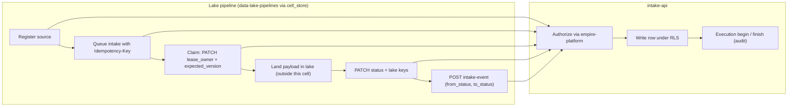
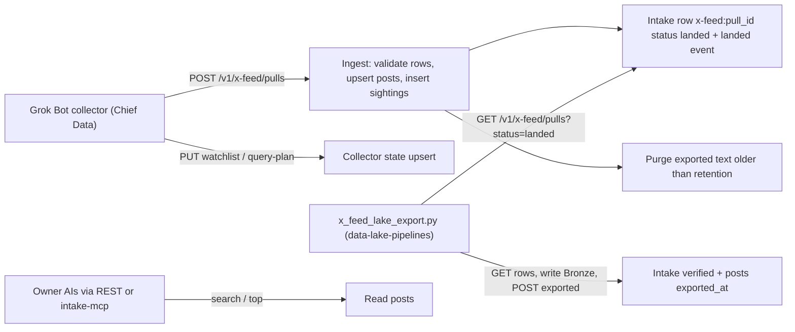

# 01 — Business process (As-Is / To-Be)

Intake cell คือ "ประตูหน้า" ของ data lake: เก็บ registry ของ data source, queue ของ intake (payload หนึ่งชิ้นที่ต้อง land ลง lake พร้อม idempotency key, lease และผลลัพธ์ใน lake) และ event trail ของทุก intake. ตัว payload จริงอยู่ใน lake ไม่ได้อยู่ที่นี่ (`PRODUCT.md`). ตั้งแต่ SPEC-002 มี source พิเศษ `x-feed` ที่ Grok Bot collector push โพสต์ X เข้ามาตรง ๆ.

ภาพ predecessor (SQLite CLI `data-intake-cli.py`, 2026-08-18) อยู่ที่ central flow pack [lake-intake](https://github.com/bookchaowalit/architecture-docs/blob/main/docs/architecture/flows/lake-intake/README.md) — reused เป็นบริบท; ข้อมูล 7 rows ถูก import จากตาราง SQLite `source_registry` / `intake_queue` มาที่ cell นี้ (`PRODUCT.md`).

## As-Is (จากโค้ดวันนี้)

### A. Generic intake queue (sources / intakes / intake-events)

Sources: `cell.yaml`, `src/cellkit/app.py`, `PRODUCT.md`, `tests/test_intake_queries.py`

### B. X feed (SPEC-002)

Sources: `src/solo_intake/x_feed.py`, `docs/x-feed-ingest.md`, `specs/002-x-feed/spec.md`

ข้อสังเกต As-Is:
- API **ไม่ enforce** การเปลี่ยน status ของ intake (event `from_status`/`to_status` ไม่ถูกเทียบกับ status จริง, `domain`/`dataset` ของ intake ไม่ถูกเทียบกับ source) — `PRODUCT.md` "Not enforced". กติกา lifecycle อยู่ที่ client.
- ทาง X feed เป็นทางเดียวที่โค้ดใน repo นี้เปลี่ยน status เอง (`landed`, `verified`, reopen กลับ `landed`).
- Lake export scheduler ยังไม่มี host (SPEC-002 risk #2) ดังนั้น pull ค้างที่ `landed` และ text ไม่ถูก purge จนกว่าจะ export.

## To-Be (จาก PRODUCT.md / specs เท่านั้น)

- `PRODUCT.md` Measures (proposed, ยังไม่มีอะไรเก็บ): intake ค้างใน `processing` เกิน `lease_expires_at`; สัดส่วน `failed`/`rejected` ต่อสัปดาห์ต่อ source; 5xx และ p95 ของ `/v1/*`.
- SPEC-002 §2/§7: lake export รันเป็น Railway cron ใน `data-schedules` (owner decision D6); ปลด Google Sheet หลัง parallel run.

## Open questions

- `platform-event-hub-api` เขียน intake ที่นี่หรือไม่ (`PRODUCT.md` [ต้องยืนยัน]).
- จะย้ายกติกา state transition (ที่ CLI เดิม enforce) มาไว้ใน API หรือคงไว้ที่ client?
- Lake export cron ใน `data-schedules` ขึ้นแล้วหรือยัง (SPEC-002 risk #2).
