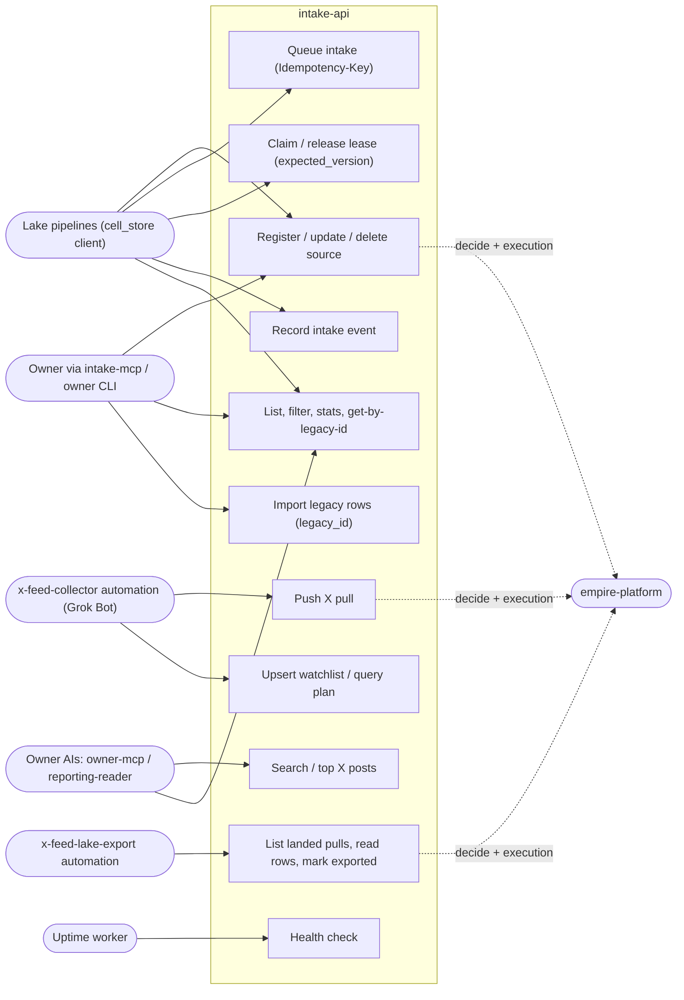

# 02 — Use cases

Actors มาจาก token ที่ cell ยอมรับ (RS256 JWT audience `intake-api`, `src/cellkit/auth.py`) และ permission `intake.<resource>:read|write|delete` ที่ empire-platform ตัดสิน (`src/cellkit/app.py` `allow()`). Automation แต่ละตัวต่างกันที่ scope ที่ platform มอบให้ (SPEC-002 §4).

Sources: `src/cellkit/app.py`, `src/cellkit/auth.py`, `src/cellkit/importer.py`, `src/cellkit/mcp.py`, `src/solo_intake/x_feed.py`, `src/solo_intake/x_feed_mcp.py`, `PRODUCT.md`, `specs/002-x-feed/spec.md`, `docs/x-feed-ingest.md`

| Actor | สิทธิ์ที่โค้ด/สเปกระบุ | หลักฐาน |
|---|---|---|
| Owner | `INTAKE_OWNER` role ใน empire-platform; owner token (no delegation) อายุ ≤ 1 ชม. | `auth.py` `MAX_LIFETIME_SECONDS`, SPEC-002 §4 |
| Lake pipelines | `intake.source/intake/intake-event:*` ตามที่ platform มอบ | `PRODUCT.md` Users |
| x-feed-collector | `intake.x-post:write`, `x-watch`, `x-query` เขียน/อ่าน; 403 บน `/v1/sources`, `/v1/intakes` | `tests/test_x_feed.py::test_the_collector_token_cannot_touch_the_rest_of_intake` |
| x-feed-lake-export | `intake.x-post:read`, `intake.x-sighting:read|write` เท่านั้น | `tests/test_x_feed.py::test_the_exporter_scopes_reach_only_x_feed_pulls` |
| owner-mcp / reporting-reader | x-feed read scopes (platform-empire PR) | SPEC-002 §4 |
| Uptime worker | ไม่มี token; `GET /health` | ops record: prod-baseline-monitoring-backups (2026-11-03), uptime `src/targets.ts` |

Channel header `X-Empire-Channel` ∈ {api, mcp, workflow, cli, event} (`auth.py` `CHANNELS`).

## Open questions

- `platform-event-hub-api` เป็น actor หรือไม่ (`PRODUCT.md` [ต้องยืนยัน]).
- รายชื่อ automation อื่นที่ถือ `intake.*` scope จริงใน platform (อยู่ใน platform-empire ไม่ใช่ repo นี้).
