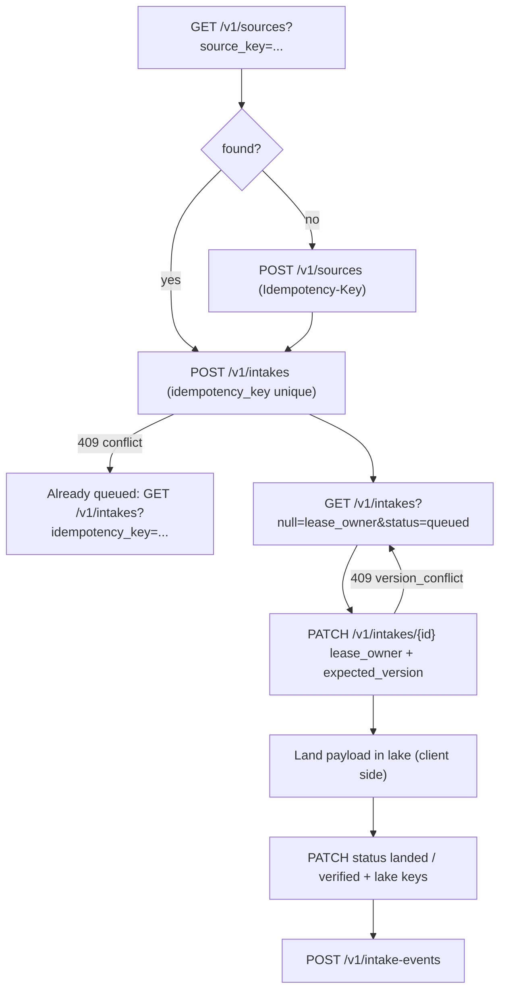
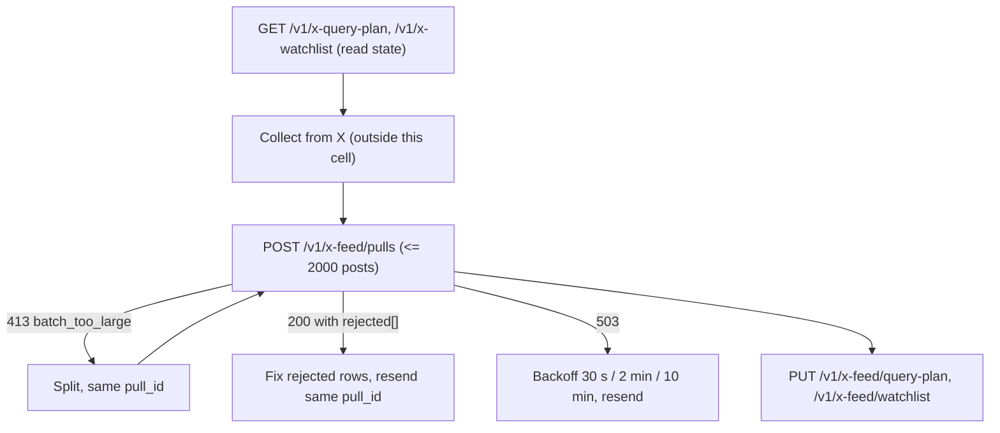
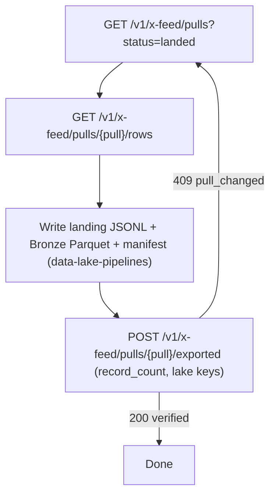
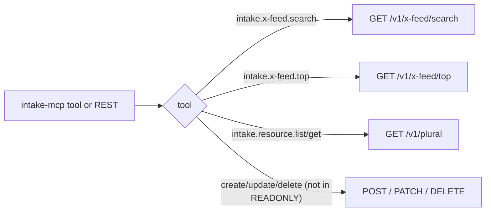

# 03 — User flows (API call flows per role)

API only ไม่มีหน้า UI (`PRODUCT.md` Platform: api) ดังนั้น "flow" คือลำดับ call ของแต่ละ role.

## Pipeline: queue → claim → land → verify

Sources: `src/cellkit/app.py` (list `null=` filter, `expected_version`, `Idempotency-Key`), `tests/test_intake_queries.py`, `tests/test_intake_defaults.py`, `PRODUCT.md`

## Collector: push a pull

Sources: `docs/x-feed-ingest.md`, `src/solo_intake/x_feed.py`

## Exporter: lake export

Sources: `docs/x-feed-ingest.md` §4, `src/solo_intake/x_feed.py` `pulls`, `pull_rows`, `exported`

## Owner / AI: read

Sources: `src/cellkit/mcp.py`, `src/solo_intake/x_feed_mcp.py`, `.mcp.json`, `AGENTS.md`

## Open questions

- client ฝั่ง pipeline ทำ claim/land/verify ตามลำดับนี้จริงหรือไม่ (โค้ด client อยู่ data-lake-pipelines / ops-toolkit ไม่ได้อ่านใน pack นี้).
