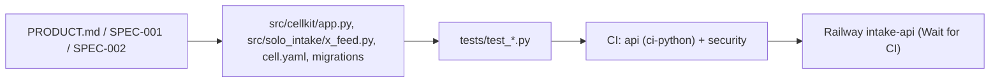

# 04 — Traceability (RTM)

Requirement มาจาก `PRODUCT.md` (Capabilities and Constraints), SPEC-001 (AC-01..AC-09) และ SPEC-002 (AC-01..AC-14). Release path เดียวกันทุกแถว: workflow `CI` (`.github/workflows/ci.yml`, jobs `api` + `security`) แล้ว Railway Wait for CI deploy `main` (`.railway/railway.ts`).

Sources: `PRODUCT.md`, `specs/001-l2-baseline/spec.md`, `specs/002-x-feed/spec.md`, `.github/workflows/ci.yml`, `.railway/railway.ts`

| Req | Requirement | Code module | Test | Release |
|---|---|---|---|---|
| S1-AC-01 | source_kind ต้องเป็นค่าที่รู้จัก | `cell.yaml` source, `migrations/0001_intake.sql` CHECK, `app.py` models | `test_intake_validation.py::test_source_kind_must_be_a_known_kind` | CI → Railway |
| S1-AC-02 | intake อ้าง source ที่หาย/ต่าง workspace ไม่ได้ (422 `reference_not_found`) | `0001` composite FK, `app.py` `write()` | `test_intake_validation.py::test_an_intake_cannot_point_at_another_workspaces_source` | CI → Railway |
| S1-AC-03 | payload เดียวกัน queue ซ้ำไม่ได้ (409) | `cell.yaml` `idempotency_key unique` | `test_intake_defaults.py::test_the_same_payload_cannot_be_queued_twice` | CI → Railway |
| S1-AC-04 | source_key unique ต่อ workspace | `0001` unique (workspace_id, source_key) | `test_intake_defaults.py::test_source_key_is_unique_within_a_workspace` | CI → Railway |
| S1-AC-05 | intake ใหม่: queued, human, attempt 0 | `cell.yaml` defaults | `test_intake_defaults.py::test_new_intake_is_queued_by_a_human_with_no_attempts` | CI → Railway |
| S1-AC-06 | source ที่มี intake ลบไม่ได้ (409 `has_dependents`) | `app.py` `write()` FK handler | `test_intake_defaults.py::test_a_source_with_intakes_cannot_be_deleted` | CI → Railway |
| S1-AC-07 | worker เดียวชนะ claim | `app.py` `update` `expected_version` | `test_intake_queries.py::test_claiming_an_intake_bumps_the_version` | CI → Railway |
| S1-AC-08 | stats group เฉพาะ filter | `app.py` `stats` | `test_intake_queries.py::test_stats_count_intakes_per_status` | CI → Railway |
| S1-AC-09 | ตัวเลขต้องพอดีคอลัมน์ / ไม่รับ NaN | `app.py` `_constraints`, `invalid_request` | `test_contract.py::test_numbers_fit_their_columns` | CI → Railway |
| P-1 | event ต้องมี intake, type (9 ค่า), to_status; actor default system | `cell.yaml` intake-event | `test_intake_validation.py::test_event_type_must_be_a_known_transition`, `test_intake_defaults.py::test_new_event_is_attributed_to_the_system` | CI → Railway |
| P-2 | import รักษา id เดิม; import ซ้ำ 409 | `app.py` `by_legacy`, `importer.py` | `test_intake_defaults.py::test_an_import_keeps_the_old_source_id`, `test_a_repeated_import_conflicts_instead_of_duplicating` | CI → Railway |
| P-3 | `null=lease_owner` คือ intake ที่ยังไม่ถูก claim | `app.py` `where()` | `test_intake_queries.py::test_unclaimed_intakes_are_listed_with_null` | CI → Railway |
| P-4 | generic CRUD, authz, isolation, idempotency ทุก resource | `app.py`, `auth.py`, `platform.py` | `test_contract.py` (kit suite จาก `cellkit/contract.py`) | CI → Railway |
| S2-AC-01..03 | pull land posts/sightings/intake; source ลงทะเบียนเอง; ส่งซ้ำไม่ซ้ำ | `x_feed.py` `ingest`, `source_id`, `land_intake`; `0002_x_feed.sql` | `test_x_feed.py::test_a_pull_lands_posts_sightings_and_an_intake_row` และอีก 5 tests | CI → Railway |
| S2-AC-04..06 | row เสียถูกรายงาน; >2000 = 413; normalise ค่าแบบ sheet | `x_feed.py` `checked_rows`, `FeedRow` | `test_bad_rows_are_reported_and_good_rows_still_land`, `test_more_than_2000_posts_is_refused`, `test_sheet_style_values_are_normalised` | CI → Railway |
| S2-AC-07/08/11a | collector/exporter scope แคบ; RLS | `x_feed.py` `ctx.allow`, `0002` RLS | `test_the_collector_token_cannot_touch_the_rest_of_intake`, `test_pulls_stay_inside_their_workspace`, `test_the_exporter_scopes_reach_only_x_feed_pulls` | CI → Railway |
| S2-AC-09/10 | upsert state; search/top | `x_feed.py` `upsert_state`, `feed` | `test_watchlist_upsert_is_idempotent_on_chief_type_value`, `test_search_by_text_tag_and_chief`, `test_top_orders_by_score` | CI → Railway |
| S2-AC-11 | export rows + mark verified; 409 `pull_changed`; reopen | `x_feed.py` `pull_rows`, `exported`, `land_intake` | `test_export_rows_then_mark_the_pull_verified`, `test_marking_a_pull_that_changed_since_the_read_is_refused`, `test_new_rows_after_export_put_the_pull_back_to_landed` | CI → Railway |
| S2-AC-12 | retention purge หลัง export เท่านั้น | `x_feed.py` `purge`, `retention_days` | `test_exported_text_older_than_the_retention_window_is_purged`, `test_a_backfill_never_purges_text_the_lake_does_not_have` | CI → Railway |
| S2-AC-13 | MCP tools search/top (read-only mode) | `x_feed_mcp.py`, `cellkit/mcp.py` | `tests/test_x_feed_mcp.py` (5 tests) | ไม่ deploy (stdio local) |
| S1 NFR | Sentry scrubbing | `cellkit/_sentry.py` | `tests/test_sentry.py` (8 tests) | CI → Railway |

Sources: test files ใน `tests/`, specs ด้านบน

## Gaps

- `PRODUCT.md` Measures (stuck lease, fail rate, 5xx/p95) ไม่มีโค้ดหรือ test.
- "Not enforced" rules ใน `PRODUCT.md` (status transitions, domain/dataset match, claimed_at < lease_expires_at) ตั้งใจไม่มี test.
- SPEC-001 และ SPEC-002 สถานะ "owner approval pending"; SPEC-001 review 2026-10-24 "changes requested" (range wording) ยังเปิด.

## Open questions

- Owner จะ approve SPEC-001/SPEC-002 หรือไม่; ใครแก้ข้อ "changes requested" ของ SPEC-001.
