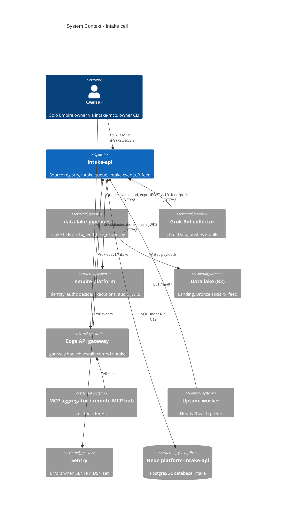

# 05 — C4 Context

Sources: `README.md`, `PRODUCT.md`, `src/cellkit/platform.py`, `src/cellkit/auth.py`, `src/cellkit/_sentry.py`, `docs/x-feed-ingest.md`, `src/cellkit/mcp.py`, ops record: api-gateway-edge (2026-11-03), ops record: prod-baseline-monitoring-backups (2026-11-03), uptime `src/targets.ts`

หมายเหตุ: cell เองไม่คุยกับ lake หรือ X; client (pipelines, Grok Bot) เป็นฝ่ายคุย. Gateway เป็นทางหนึ่ง แต่ `*.up.railway.app` ยังเปิดตรง (README, uptime target, `docs/x-feed-ingest.md` base URL).

## Open questions

- จะให้ทุก client ผ่าน gateway แล้วปิด direct `intake-api-production.up.railway.app` หรือไม่ (collector contract ยังชี้ direct URL).
