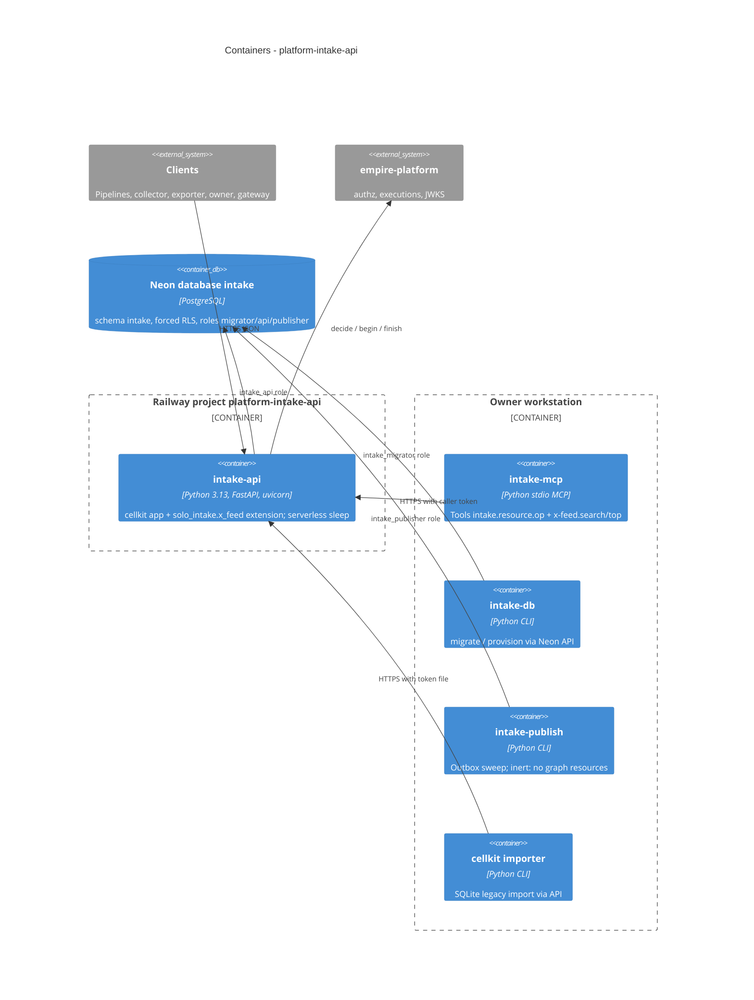

# 06 — C4 Container

Sources: `Dockerfile`, `pyproject.toml` (`[project.scripts]`), `.railway/railway.ts`, `.mcp.json`, `src/cellkit/server.py`, `src/cellkit/db.py`, `src/cellkit/publisher.py`, `src/cellkit/importer.py`, `db/roles.sql`, `migrations/0001_intake.sql`

- Image รันแค่ `intake-api` (`Dockerfile` `CMD`), ไม่มี `mcp` extra (`uv sync --no-dev`; `x_feed_mcp.py` แยกออกมาเพราะเหตุนี้).
- `.railway/railway.ts` ประกาศ service เดียว (`intake-api`); ไม่มี cron publisher. `cell.yaml` ไม่มี resource ใดประกาศ `graph` ดังนั้น outbox ไม่ถูกเขียนและ `intake-publish` ไม่มีงาน (`docs/cellkit-notes.md`).

## Open questions

- `intake-db migrate` สำหรับ prod รันจากที่ไหน/ใคร (ops record x-feed-intake-source บอกว่า owner รัน 0002 ด้วย migrator URL ในหน่วยความจำ 2026-10-28) — ควรเป็นขั้นตอนใน runbook หรือไม่.
