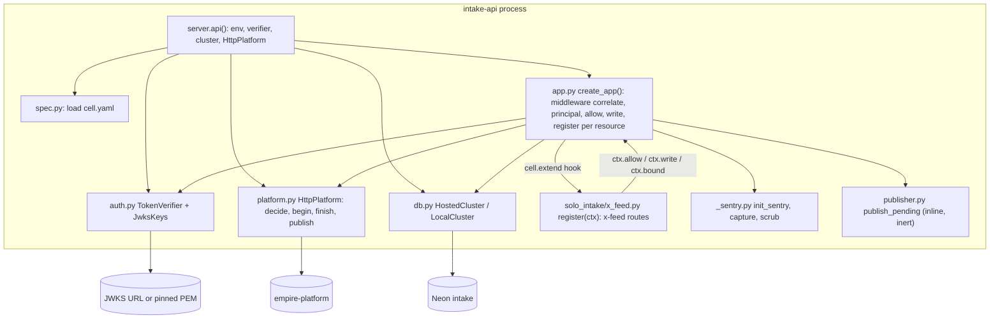

# 07 — C4 Component (intake-api process)

Sources: `src/cellkit/server.py`, `src/cellkit/app.py`, `src/cellkit/auth.py`, `src/cellkit/platform.py`, `src/cellkit/db.py`, `src/cellkit/spec.py`, `src/cellkit/_sentry.py`, `src/cellkit/publisher.py`, `src/solo_intake/x_feed.py`, `cell.yaml`

| Component | หน้าที่ |
|---|---|
| `spec.py` / `sqlgen.py` | อ่าน `cell.yaml` → Resource/Field; สร้าง SQL select ต่อ resource |
| `app.py` | generic routes 7 ตัวต่อ resource + `/health`; `write()` = precheck → local change → `platform.begin` → commit → `platform.finish` |
| `auth.py` | ตรวจ RS256, `aud`=`intake-api`, `iss`, ต้องมี `exp/iat/sub/jti`, lifetime ≤ 1 ชม. (owner) / ≤ 30 วัน (delegated) |
| `platform.py` | client ของ empire-platform; fail closed; บังคับ https ยกเว้น loopback |
| `x_feed.py` | 8 routes x-feed; lock order: source row ก่อนเสมอ |
| `mcp.py` + `x_feed_mcp.py` | (process แยก, ไม่อยู่ใน image) |
