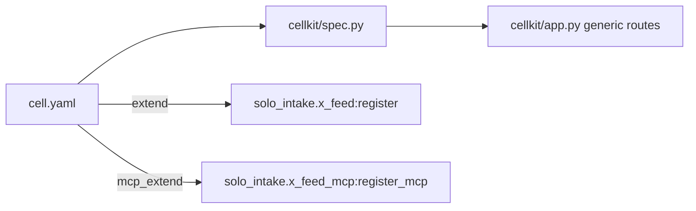

# ADR-0001 — Cell described by `cell.yaml`, served by repo-owned `cellkit` (FastAPI)

- Status: accepted (retro-documented)
- Date of evidence: 2026-10-10 (`bdc1218 feat: intake cell from solo-cell-kit`), 2026-10-12 (`89ab6a1` shared kit retired), 2026-10-21 owner decision (each service owns its code)

## Context
Cell หลายตัวต้องการ CRUD + authz + RLS แบบเดียวกัน. Generator กลาง (solo-cell-kit) ถูกเลิกใช้ 2026-10-12.

## Decision
Resource, field, filter, unique และ extension hook ประกาศใน `cell.yaml`; โค้ดใน `src/cellkit/` (FastAPI, psycopg, pyjwt, uvicorn[standard]) เป็นของ repo นี้ แก้ที่นี่เท่านั้น. Logic เฉพาะ cell อยู่ `src/solo_intake/` ผ่าน `extend:` / `mcp_extend:`.

## Consequences
- ทุก resource ได้ list/stats/get/legacy/create/patch/delete และ contract suite (`tests/test_contract.py`) ฟรี.
- ต้องแก้ bug ของ kit แยกในทุก cell copy (`docs/cellkit-notes.md`).

Evidence: `cell.yaml`, `src/cellkit/`, `pyproject.toml`, `AGENTS.md`, `docs/cellkit-notes.md`, git log `bdc1218`, `89ab6a1`
