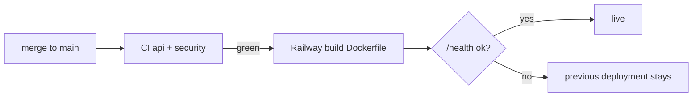

# ADR-0002 — Railway serverless service, deployed from GitHub `main` with Wait for CI

- Status: accepted (retro-documented)
- Date of evidence: 2026-10-18 (`5bb5aca`, `8f402b8`)

## Context
เดิม deploy ด้วย `railway up` จาก working tree; ต้องการให้ production รันเฉพาะโค้ดที่ CI ผ่าน.

## Decision
Service `intake-api` ใน Railway project `platform-intake-api`, source = GitHub `bookchaowalit/platform-intake-api` branch `main`, `checkSuites: true`, healthcheck `/health` (60 s), `sleepApplication: true` (serverless). Region Singapore ตั้งด้วย `railway scale` หลัง deploy แรก. Image จาก `Dockerfile` (python:3.13-slim, `uv sync --frozen`, non-root uid 10001).

## Consequences
- `railway up` ไม่ใช้แล้ว; rollback = redeploy deployment เก่าใน Railway.
- ตั้งแต่ 2026-10-28 deploy ค้างที่ `NEEDS_APPROVAL` ต้อง approve เอง (ops record: railway-deploy-approval-gate (2026-11-03)).
- Cold start หลัง sleep; uptime probe ทุกชั่วโมงแทนทุก 5 นาที (uptime `src/targets.ts` `SLEEPS`).

Evidence: `.railway/railway.ts`, `Dockerfile`, `README.md`, `AGENTS.md`, `PRODUCT.md`
