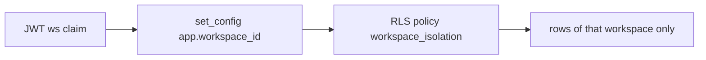

# ADR-0003 — Own Neon PostgreSQL database with forced row-level security per workspace

- Status: accepted (retro-documented)
- Date of evidence: 2026-10-10 (`migrations/0001_intake.sql`), 2026-10-13 rename (`dccb64e`)

## Context
Cell ต้อง workspace-scoped (รองรับ tenant อื่นโดยไม่แก้โค้ด, `PRODUCT.md` Positioning) และเลิกใช้ SQLite กลาง.

## Decision
Neon project `platform-intake-api`, database `intake`, schema `intake`. ทุกตารางมี `workspace_id` เป็นส่วนของ PK, RLS `ENABLE` + `FORCE` ด้วย policy `workspace_id = intake.current_workspace()` (จาก `app.workspace_id` ที่ `bound()` ตั้งต่อ transaction). 3 roles: `intake_migrator` (owner schema), `intake_api` (NOBYPASSRLS, NOINHERIT, ไม่ owner อะไร), `intake_publisher` (เฉพาะ outbox). Migration append-only, ตรวจ sha256 ใน `public.schema_migrations`.

## Consequences
- Isolation ทดสอบใน `test_contract.py::test_workspace_isolation`, `test_x_feed.py::test_pulls_stay_inside_their_workspace`.

Evidence: `migrations/0001_intake.sql`, `migrations/0002_x_feed.sql`, `db/roles.sql`, `src/cellkit/db.py`, `src/cellkit/app.py` `bound()`
