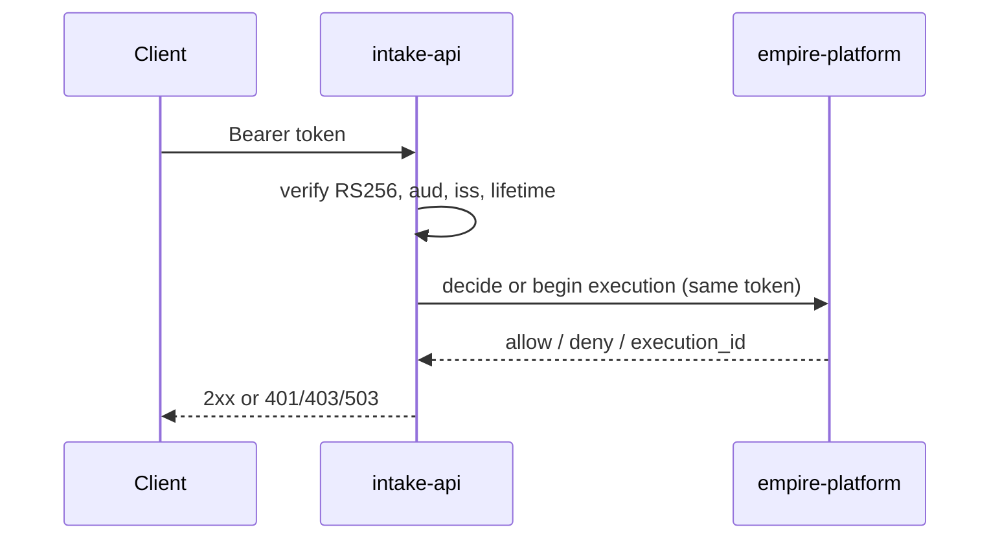

# ADR-0004 — Authorization, executions and audit delegated to empire-platform with the caller's token

- Status: accepted (retro-documented)
- Date of evidence: 2026-10-10 (`src/cellkit/platform.py`), JWKS 2026-10-13 (`30d599f`)

## Context
ไม่ต้องการให้แต่ละ cell มี permission model เอง.

## Decision
Cell ตรวจ JWT RS256 ในเครื่องเพื่อ reject เร็วและ bind workspace (`auth.py`); ส่ง token ของ caller ต่อให้ empire-platform: `POST /v1/authz/decide` สำหรับ read, `POST /v1/executions` + `/finish` สำหรับ write (ผูกกับ record id และ idempotency key). ข้อผิดพลาดของ transport = deny/503 (fail closed). Key จาก JWKS (cache 10 นาที, refetch unknown kid ≤ 1/นาที) หรือ PEM pinned.

## Consequences
- ทุก write มี audit record ใน platform (`before_hash`/`after_hash`), finish ล้มเหลว = write สำเร็จแต่ log + Sentry.
- Platform ล่ม = cell ตอบ 503 `authorization_unavailable` ทุก request ที่ต้องตัดสิน.

Evidence: `src/cellkit/auth.py`, `src/cellkit/platform.py`, `src/cellkit/app.py` (`allow`, `write`, `audit`), `src/cellkit/server.py`
