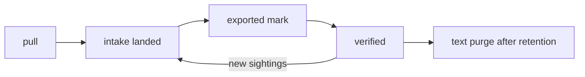

# ADR-0005 — X feed lands as an intake source with narrow automation scopes and post-export retention

- Status: accepted (retro-documented; SPEC-002 owner approval pending)
- Date of evidence: 2026-10-26 (`8b6dd4e`), live 2026-10-28 (`5be3f7d`)

## Context
X posts อยู่ใน Google Sheet นอกระบบกลาง (SPEC-002 §1).

## Decision
เพิ่ม 4 resources (`x-post`, `x-sighting`, `x-watch`, `x-query`) และ routes `/v1/x-feed/*`. แต่ละ pull = intake row `x-feed:<pull_id>` ของ source `x-feed` (dataset `x_feed`) เพื่อใช้ trail/freshness/lineage เดิม. Collector ได้แค่ `intake.x-*`; exporter mark ด้วย `intake.x-sighting:write` ไม่ใช่ `intake.intake:*`. Text ถูก purge หลัง export และเกิน `INTAKE_X_FEED_RETENTION_DAYS` (default 180).

## Consequences
- Push idempotent โดยไม่ต้องใช้ Idempotency-Key header.
- Token collector 30 วัน หมุนด้วยมือ (`docs/x-feed-ingest.md` Token).
- ถ้า exporter ไม่รัน text ไม่เคยถูก purge (SPEC-002 risk #2).

Evidence: `specs/002-x-feed/spec.md`, `docs/x-feed-ingest.md`, `src/solo_intake/x_feed.py`, `migrations/0002_x_feed.sql`
