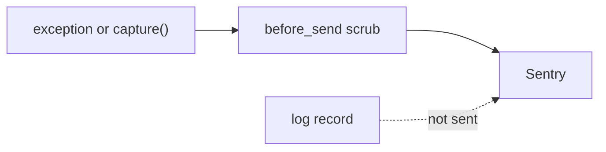

# ADR-0006 — Sentry for errors only, with secret scrubbing and no tracing

- Status: accepted (retro-documented)
- Date of evidence: 2026-10-18 (PR #2–#5: `056ab86`, `5a24139`, `6120df1`, `7d670ce`)

## Decision
`SENTRY_DSN` ว่าง = no-op. เมื่อเปิด: `traces_sample_rate=None`, `send_default_pii=False`, ไม่มี local variables, ไม่มี request body, log records ไม่เป็น event/breadcrumb, `before_send` scrub URL password / bearer / JWT และเก็บ request แค่ method. `release` = `RAILWAY_GIT_COMMIT_SHA`.

## Consequences
- ไม่มี performance data ใน Sentry; latency ต้องหาที่อื่น.
- Tests: `tests/test_sentry.py` (8).

Evidence: `src/cellkit/_sentry.py`, `tests/test_sentry.py`, git log PR #2–#5
