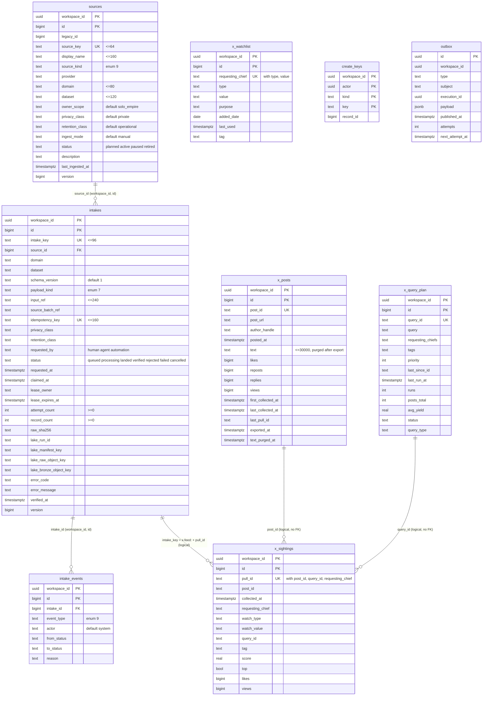

# 09 — ERD

Schema `intake` บน Neon database `intake`. ทุกตาราง (ยกเว้น `outbox` ที่มี `id uuid` PK) ใช้ PK `(workspace_id, id)`, id เริ่ม 1,000,000, มี `legacy_id` (unique ต่อ workspace เมื่อไม่ null), `version`, `created_at`, `updated_at`; RLS forced ทุกตาราง.

Sources: `migrations/0001_intake.sql`, `migrations/0002_x_feed.sql`, `cell.yaml`, `db/roles.sql`

- `create_keys`: สงวน record id ต่อ (workspace, actor, kind, Idempotency-Key) ก่อนเริ่ม execution; `kind` ขยายเป็น 7 ค่าใน 0002.
- `outbox`: มีไว้สำหรับ graph events แต่ไม่มี resource ใดใน `cell.yaml` ประกาศ `graph` → ไม่มี row ถูกเขียน (`docs/cellkit-notes.md`).
- `x_sightings` แสดงเฉพาะบางคอลัมน์ (มี `reposts`, `replies` ด้วย); `x_query_plan` มีคอลัมน์สถิติเพิ่ม (`calls_total`, `new_posts_last`, `calls_last_run`, `yield_last6`, `lang_filter`, `watchlist_rows`) — ดู `cell.yaml`.
- ความสัมพันธ์ X feed เป็น logical (join ใน `x_feed.py`), ไม่มี FK ใน DB.
- Grants: `intake_api` SELECT/INSERT/UPDATE/DELETE บนตารางข้อมูล, INSERT-only บน `create_keys`; `intake_publisher` อ่าน/อัปเดตคอลัมน์ publish ของ `outbox` ผ่าน policy `publisher_sweep`.

Central ERD (เก่า, SQLite `source_registry`/`intake_queue`): https://github.com/bookchaowalit/architecture-docs/blob/main/docs/architecture/ERD-DIAGRAMS.md
