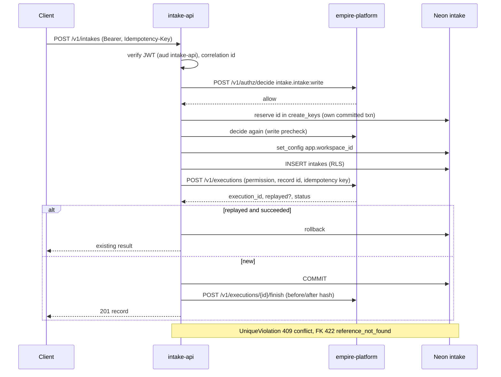
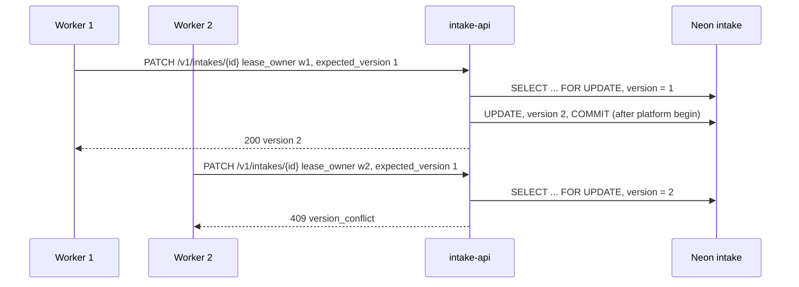
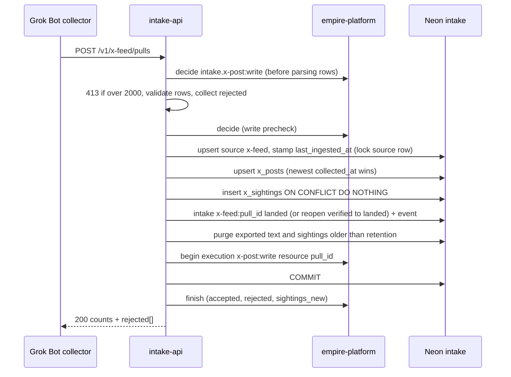
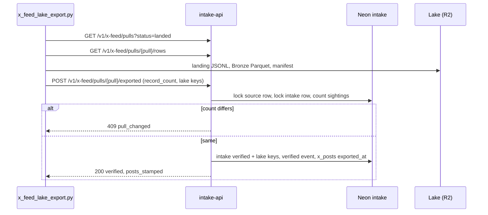

# 10 — Sequences

## 1. Generic create (เช่น `POST /v1/intakes` พร้อม `Idempotency-Key`)

Sources: `src/cellkit/app.py` (`create`, `reserve`, `write`, `audit`), `src/cellkit/platform.py`, `src/cellkit/auth.py`

## 2. Claim an intake (optimistic lock)

Sources: `src/cellkit/app.py` (`update`), `tests/test_intake_queries.py::test_claiming_an_intake_bumps_the_version`

## 3. X feed push

Sources: `src/solo_intake/x_feed.py` (`ingest`, `source_id`, `land_intake`, `purge`), `docs/x-feed-ingest.md`

## 4. Lake export mark

Sources: `src/solo_intake/x_feed.py` (`pulls`, `pull_rows`, `exported`), `docs/x-feed-ingest.md` §4
