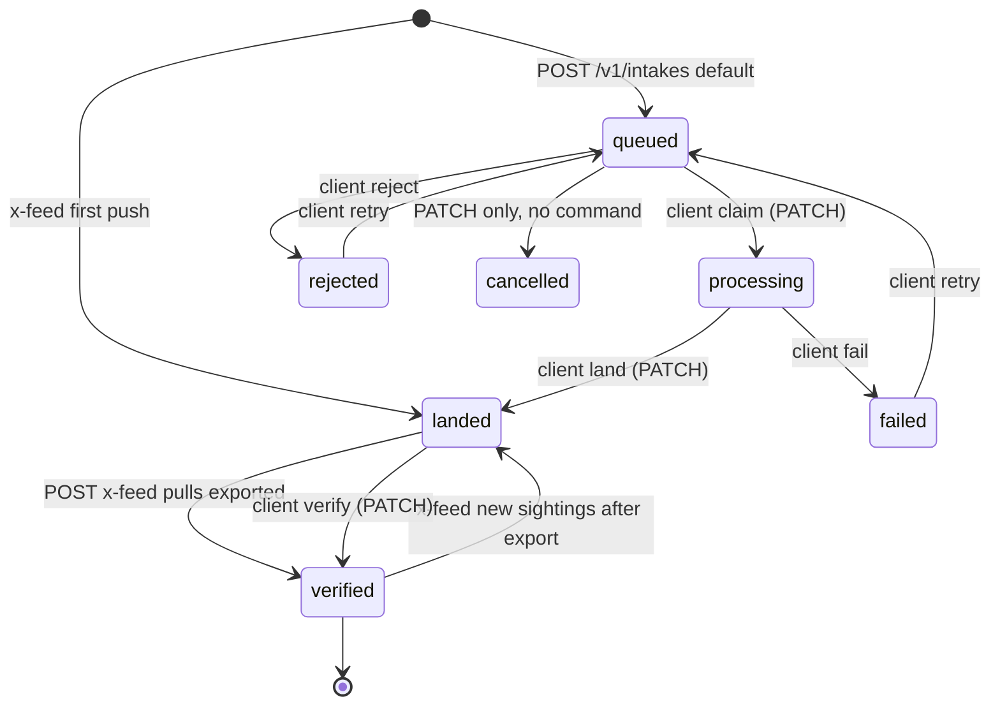
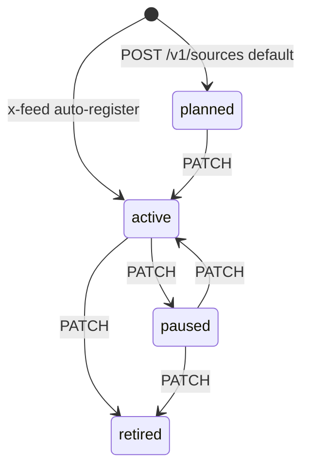
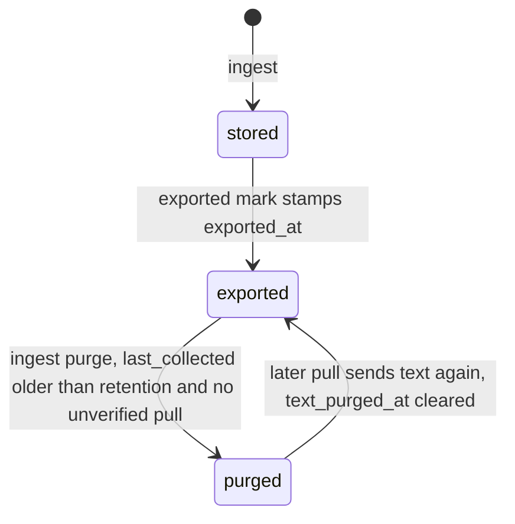
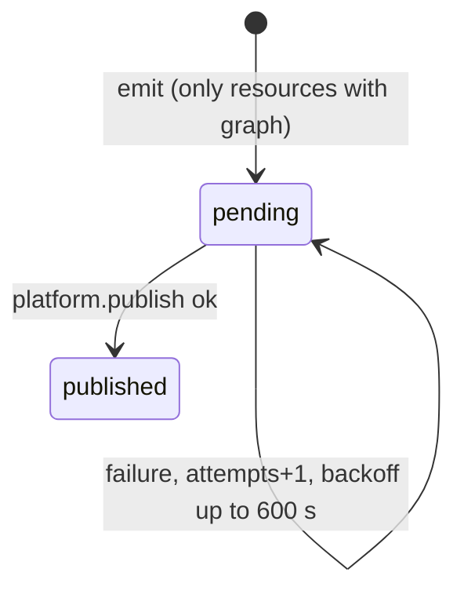

# 11 — State machines

## Intake `status` (as stored)

Schema อนุญาต 7 ค่า (`cell.yaml`, CHECK ใน `0001`). Generic API **ไม่ตรวจ transition** — PATCH ตั้งค่าใดก็ได้ใน enum (`PRODUCT.md` "Not enforced"). เส้นทึบด้านล่างคือที่โค้ดใน repo นี้ทำเอง (X feed); เส้นประคือ lifecycle ที่ CLI predecessor enforce (central [04-state-machine](https://github.com/bookchaowalit/architecture-docs/blob/main/docs/architecture/flows/lake-intake/04-state-machine.md)) ซึ่ง client อาจทำตาม.

Sources: `cell.yaml`, `migrations/0001_intake.sql`, `src/solo_intake/x_feed.py` (`land_intake`, `exported`), `PRODUCT.md`

Lease: `lease_owner` + `expected_version` ทำให้ claim ได้คนเดียว (409 อีกคน); `claimed_at < lease_expires_at` ไม่ถูกตรวจ (`docs/cellkit-notes.md` "Range not declared").

## Intake event types

`event_type` ∈ {queued, claimed, lease_renewed, landed, verified, rejected, failed, retried, cancelled} — เป็น log ไม่ใช่ state; X feed เขียน `landed` (from null หรือ verified) และ `verified` ด้วย `actor` = `x-feed`.

## Source `status`

Sources: `cell.yaml` source `status`, `src/solo_intake/x_feed.py` `source_id`. Transition ใด ๆ ภายใน enum ผ่าน PATCH ได้หมด (ไม่มีกฎในโค้ด); ภาพนี้ตาม central pack.

## X post text lifecycle

Sources: `src/solo_intake/x_feed.py` (`UPSERT_POSTS`, `purge`, `exported`), `docs/x-feed-ingest.md` §4. `exported_at` ไม่ถูกล้างเมื่อมี pull ใหม่; แต่ post ที่อยู่ใน pull ที่ยังไม่ verified จะไม่ถูก purge.

## Outbox row (inert in this cell)

Sources: `src/cellkit/app.py` `emit`, `src/cellkit/publisher.py`. ไม่มี resource ไหนใน `cell.yaml` มี `graph` จึงไม่เกิดจริง.
