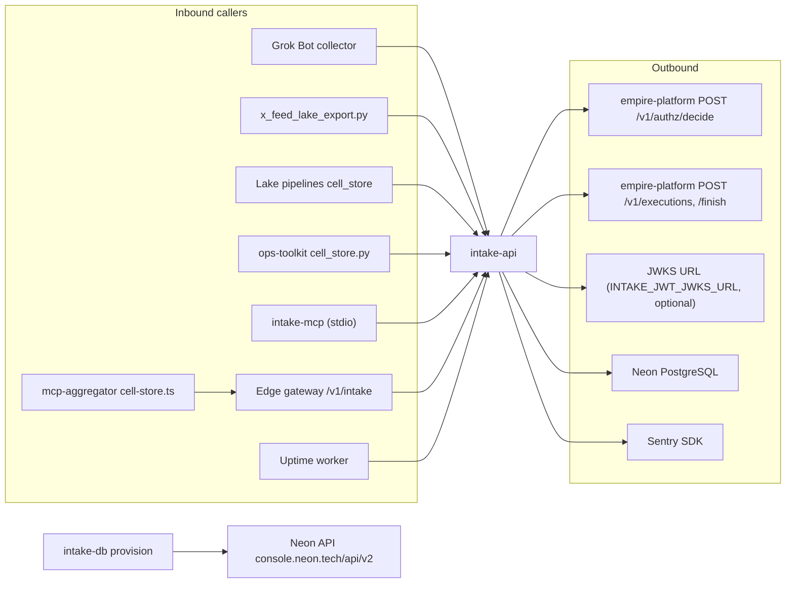

# 12 — API and integrations

ตาราง endpoint หลัก reuse จาก [README.md](../../README.md#api) และ [docs/x-feed-ingest.md](../x-feed-ingest.md) (contract ฉบับเต็ม). ด้านล่างสรุปและวาด integration.

## Endpoints

| Route | Method | Permission | Source |
|---|---|---|---|
| `/v1/{plural}` (sources, intakes, intake-events, x-posts, x-sightings, x-watchlist, x-query-plan) | GET list (filters, `null=`, limit/offset/order) | `intake.<r>:read` | `app.py` |
| `/v1/{plural}/stats?group_by=` | GET | read | `app.py` |
| `/v1/{plural}/legacy/{legacy_id}` | GET | read | `app.py` |
| `/v1/{plural}/{id}` | GET / PATCH (`expected_version`) / DELETE | read / write / delete | `app.py` |
| `/v1/{plural}` | POST (`Idempotency-Key` 8–200) | write | `app.py` |
| `/v1/x-feed/pulls` | POST | `intake.x-post:write` | `x_feed.py` |
| `/v1/x-feed/watchlist` | PUT | `intake.x-watch:write` | `x_feed.py` |
| `/v1/x-feed/query-plan` | PUT | `intake.x-query:write` | `x_feed.py` |
| `/v1/x-feed/search`, `/v1/x-feed/top` | GET | x-post + x-sighting read | `x_feed.py` |
| `/v1/x-feed/pulls?status=landed|verified` | GET | same reads | `x_feed.py` |
| `/v1/x-feed/pulls/{pull}/rows` | GET | same reads | `x_feed.py` |
| `/v1/x-feed/pulls/{pull}/exported` | POST | `intake.x-sighting:write` | `x_feed.py` |
| `/health` | GET | none | `app.py` |
| `/docs`, `/openapi.json` | GET | none (FastAPI default) | `app.py` `FastAPI(...)` |

Headers: `Authorization: Bearer`, `X-Empire-Channel`, `X-Correlation-Id` (echoed back). Error body `{"detail": {"error": ...}}`.

## Integrations

Sources: `src/cellkit/app.py`, `src/cellkit/platform.py`, `src/cellkit/auth.py`, `src/cellkit/server.py`, `src/cellkit/db.py`, `src/cellkit/mcp.py`, `src/solo_intake/x_feed.py`, `PRODUCT.md`, `docs/x-feed-ingest.md`, ops record: api-gateway-edge (2026-11-03)

- `POST /v1/graph/events` (`platform.publish`) มีในโค้ดแต่ไม่ถูกเรียก (ไม่มี graph resource).
- MCP stdio ไม่ deploy; เรียก API ด้วย `EMPIRE_INTAKE_API` และ token ของ caller.

## Open questions

- `/docs` และ `/openapi.json` เปิดสาธารณะ — ตั้งใจหรือไม่ (gateway มี tokenless `openapi.json` path สำหรับ `describe_cell`, ops record api-gateway-edge).
- ใช้ JWKS (`INTAKE_JWT_JWKS_URL`) หรือ PEM pinned ใน production — README ระบุเฉพาะ `INTAKE_JWT_PUBLIC_KEY_PEM`.
