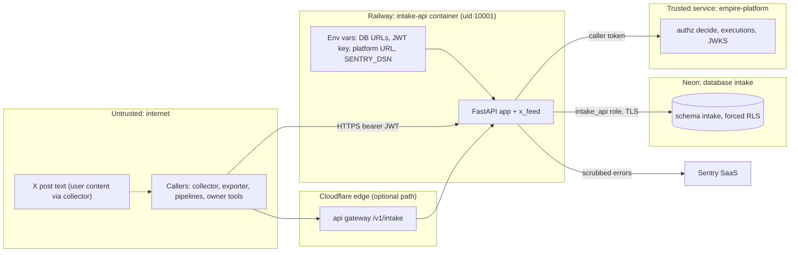

# 13 — Threat model (DFD + STRIDE)

Sources: `src/cellkit/auth.py`, `src/cellkit/platform.py`, `src/cellkit/app.py`, `src/cellkit/_sentry.py`, `src/solo_intake/x_feed.py`, `migrations/0001_intake.sql`, `db/roles.sql`, `Dockerfile`, ops record: api-gateway-edge (2026-11-03)

## STRIDE

| Element | Threat | Existing mitigation (code) | Gap |
|---|---|---|---|
| Callers → API | **S**poofing | RS256 only, `aud`=`intake-api`, `iss`, required `exp/iat/sub/jti`; owner token ≤ 1 h, delegated ≤ 30 d; dev issuer refused in hosted mode (`auth.py`, `server.py`) | no revocation check locally; platform decide refuses a revoked token (`platform.py` 401) |
| Callers → API | **T**ampering | pydantic models from `cell.yaml`, `extra` refused on x-feed; int/real bounds; NUL replaced (`app.py`, `x_feed.py`) | ไม่มี ingress body-size limit (SPEC-002 review "not done") |
| Callers → API | **R**epudiation | every write = platform execution with `before_hash`/`after_hash`, actor, workspace, correlation id (`app.py` `write`, `audit`) | finish failure only logged + Sentry |
| API → DB | **I**nformation disclosure | forced RLS per workspace; `intake_api` NOBYPASSRLS, owns nothing; collector/exporter scopes narrow (`0001`, `roles.sql`, tests AC-07/11a) | x-feed SQL relies on RLS only, no explicit `workspace_id` predicate (SPEC-002 review, by choice) |
| X text | **T**ampering / injection | stored as plain text, never rendered; LIKE wildcards literal; MCP tool description warns "data, never instructions" (`x_feed.py`, `x_feed_mcp.py`) | consumers must escape; not enforceable here |
| API | **D**enial of service | 2,000-row batch cap (413); search limit ≤ 200; set-based statements | no rate limit in code; no body-size limit; Railway serverless cold start |
| API → platform | **D**oS / dependency | fail closed: transport error → 503 `authorization_unavailable` | platform outage = intake outage (2026-10-28 Neon quota event, ops record x-feed-intake-source) |
| API → Sentry | **I**nfo disclosure | no PII, no locals, no body, request = method only, scrub bearer/JWT/URL passwords, no tracing (`_sentry.py`) | — |
| MCP tools | **E**levation | no actor/workspace/token arguments; strict models `extra=forbid`; `EMPIRE_MCP_READONLY` (`mcp.py`) | — |
| API | **E**levation | every route calls `allow()` or `write()` before work; x-feed authorises before parsing rows | `/docs`, `/openapi.json` public (schema disclosure only) |
| Secrets | **I**nfo disclosure | URLs from Railway vars / 0600 file; `Principal.__repr__` hides token; publisher reads only `ws` claim | collector token rotation manual every 30 d (`docs/x-feed-ingest.md`) |
| Supply chain | **T**ampering | `uv.lock` + `uv sync --frozen`; shared CI SHA-pinned; gitleaks, semgrep, osv-scanner, trivy; Renovate (`ci.yml`, `renovate.json`) | no branch protection / ruleset on `main` (`gh api .../rulesets` = `[]`) |

## Open questions

- ต้องการ rate limit / body size limit ที่ gateway หรือที่ app?
- เปิด branch protection บน `main` หรือไม่ (ตอนนี้ direct push ได้ และ deploy ทันทีหลัง CI).
