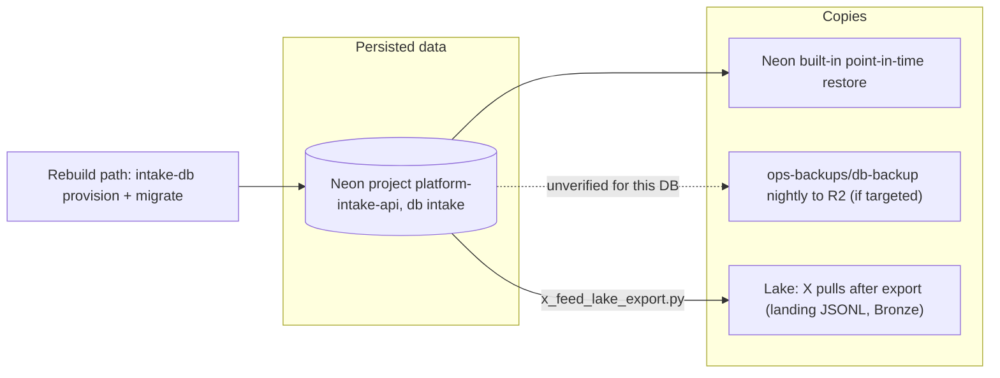

# 14 — Backup and DR

Sources: `src/cellkit/db.py` (`provision`, `migrate`), `docs/x-feed-ingest.md` §4, `PRODUCT.md`, ops record: prod-baseline-monitoring-backups (2026-11-03), platform-db-backup `README.md` @ 27a0a68

| Data | Where | Backup reality | Restore |
|---|---|---|---|
| sources, intakes, intake_events (metadata + lineage) | Neon `intake` | Neon PITR (provider feature). Nightly `ops-backups/db-backup` covers "the 30 Neon databases of own services" — รายชื่อ target อยู่ใน Railway variables `BACKUP_URL_*` ไม่อยู่ใน repo, จึง **ยืนยันไม่ได้** ว่ารวม intake | Neon branch restore; หรือ `platform-db-backup` `scripts/restore.sh` ถ้ามี dump |
| x_posts, x_sightings | Neon `intake` | ส่วนที่ export แล้วอยู่ใน lake (R2 Bronze `social/x_feed`); text ใน Neon purge หลัง 180 วัน | re-export ไม่ได้หลัง purge; lake คือ history (`docs/x-feed-ingest.md`) |
| x_watchlist, x_query_plan (collector state) | Neon `intake` | เหมือน metadata; ไม่มีสำเนาที่อื่น (sheet เดิมยัง parallel run ตาม SPEC-002) | — |
| create_keys | Neon `intake` | — | สูญเสียได้: ทำให้ replay ของ Idempotency-Key เดิมสร้างใหม่ |
| Payloads | Data lake (not here) | outside this repo | — |
| Schema | `migrations/*.sql` in Git | Git | `intake-db migrate` |

- RTO / RPO: **not defined** (ไม่มีใน `PRODUCT.md`, specs หรือ README).
- Restore drill รายเดือนมีใน ops record (prod-baseline) แต่ไม่ระบุว่าเลือก DB ไหน.
- Service ไม่มี state ใน container; redeploy deployment เก่าใน Railway คือ rollback (`README.md`).

## Open questions

- `BACKUP_URL_INTAKE` (หรือชื่อที่ใช้) อยู่ใน `ops-backups` แล้วหรือยัง? มี `db_backup` role ใน Neon project นี้หรือไม่?
- RTO/RPO ที่ต้องการ.
- Neon PITR window ของ project นี้ (free plan) เท่าไร.
