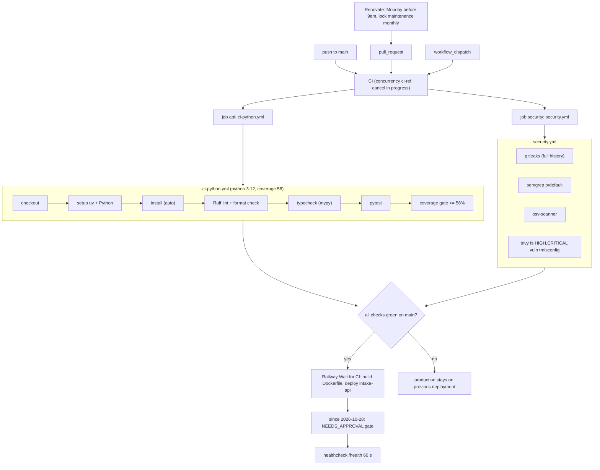

# 15 — CI/CD pipeline

Workflow เดียว: `.github/workflows/ci.yml` (`CI`), เรียก reusable workflows ของ `bookchaowalit/platform-ci-workflows` pinned ที่ `87dc5e1` (v1.1.1). Public repo → GitHub-hosted `ubuntu-24.04`.

Sources: `.github/workflows/ci.yml`, platform-ci-workflows `ci-python.yml` / `security.yml` @ `87dc5e1`, `.railway/railway.ts`, `renovate.json`, `README.md`, ops record: railway-deploy-approval-gate (2026-11-03)

- Tests ใช้ embedded PostgreSQL (`pgserver`, dev extra) ไม่ใช่ service ของ CI (`postgres` input ไม่ได้ตั้ง), จึง pin Python 3.12 ใน CI ส่วน image เป็น 3.13 (`ci.yml` comment).
- Migration ไม่อยู่ใน pipeline: ต้องรัน `intake-db migrate` แยก (ไม่มี job/step).

## Open questions

- ควรเพิ่ม step migrate (หรือตรวจ pending migration) ก่อน deploy หรือไม่?
- NEEDS_APPROVAL gate ยังเปิดอยู่หรือไม่ ณ วันนี้.
