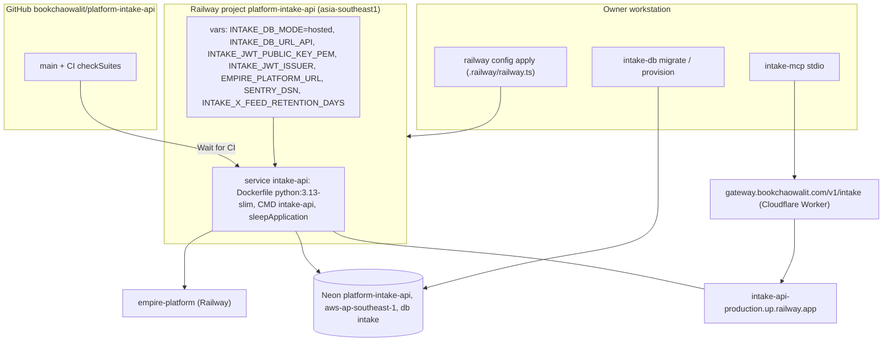

# 16 — Deployment

Sources: `.railway/railway.ts`, `Dockerfile`, `README.md`, `PRODUCT.md`, `src/cellkit/server.py`, `src/cellkit/db.py`, `package.json`, ops record: api-gateway-edge (2026-11-03), uptime `src/targets.ts`

| Item | Value | Source |
|---|---|---|
| Runtime | uvicorn, host `0.0.0.0` in hosted mode, `PORT` env (default 3624), `proxy_headers=False` | `server.py`, `cell.yaml` |
| Region | Singapore; set with `railway scale` (IaC ไม่มี region) | `.railway/railway.ts`, `README.md` |
| Health | `/health` returns `{"status":"ok"}` (ไม่แตะ DB) | `app.py` |
| Release tag in Sentry | `RAILWAY_GIT_COMMIT_SHA` | `_sentry.py` |
| Variables | unmanaged by IaC (`variables: { managed: false }`) | `.railway/railway.ts` |
| Live commit | `5be3f7d` (2026-10-28) ตาม ops record x-feed-intake-source | ops record |

## Open questions

- Commit ที่ live ตอนนี้ (ops record ล่าสุด 2026-10-28) — ไม่มีอะไร merge หลังจากนั้น แต่ยังไม่ได้ตรวจ Railway.
- `INTAKE_JWT_JWKS_URL` ตั้งใน production หรือไม่.
