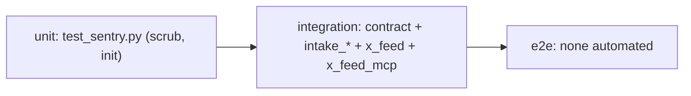

# 17 — Test coverage matrix

ทุก test ใช้ FastAPI TestClient + throwaway PostgreSQL (`pgserver`) + fake platform (`src/cellkit/testing.py`) — นับเป็น integration. ไม่มี e2e อัตโนมัติกับ hosted; local e2e ของ X feed ทำด้วยมือ 2026-10-26 (SPEC-002 §6). Coverage gate 56% (วัดได้ 58.50% 2026-10-22).

Sources: `tests/*.py`, `src/cellkit/testing.py`, `src/cellkit/contract.py`, `.github/workflows/ci.yml`, `specs/002-x-feed/spec.md`

| Feature | Unit | Integration | E2E | Test file(s) |
|---|---|---|---|---|
| Generic CRUD lifecycle, validation, version conflict, missing ref | — | yes | — | `test_contract.py` (kit `contract.py`: 17 tests, most parametrised per resource) |
| Authorization / workspace isolation / idempotent create | — | yes | — | `test_contract.py` |
| JWKS verification + PEM fallback | — | yes | — | `test_contract.py` (`test_jwks_*`) |
| Outbox publish / inline failure | — | yes (inert in prod) | — | `test_contract.py` |
| Source rules (kinds, enums, lengths, unique key) | — | yes | — | `test_intake_validation.py`, `test_intake_defaults.py` |
| Intake rules (required, enums, counts ≥ 0, refs) | — | yes | — | `test_intake_validation.py`, `test_intake_defaults.py` |
| Intake events | — | yes | — | `test_intake_validation.py`, `test_intake_queries.py` |
| Filters, `null=`, stats | — | yes | — | `test_intake_queries.py` |
| Lease claim / release | — | yes | — | `test_intake_queries.py` |
| Legacy import | — | yes | — | `test_intake_defaults.py`, `test_contract.py::test_import_keeps_the_old_id` |
| X feed ingest, idempotency, normalisation | — | yes | manual 2026-10-26 | `test_x_feed.py` |
| X feed scopes (collector, exporter, reader) | — | yes | manual | `test_x_feed.py` |
| X feed export + reopen + retention purge | — | yes | manual | `test_x_feed.py` |
| MCP tools x-feed search/top, strict args | — | yes | — | `test_x_feed_mcp.py` |
| Sentry scrubbing | yes | — | — | `test_sentry.py` |
| `cellkit/importer.py` CLI | — | — | — | **gap** |
| `cellkit/db.py` provision (Neon API) | — | — | — | **gap** |
| `cellkit/publisher.py` CLI `intake-publish` | — | partly (via contract) | — | — |
| `/health` | — | — | uptime probe | — |

## Gaps

- ไม่มี test ที่รันกับ Neon/Railway จริง; ไม่มี smoke test หลัง deploy อัตโนมัติ (`AGENTS.md` ให้ verify `/health` + 1 authorized read ด้วยมือ).
- Provision/importer ไม่มี test.
