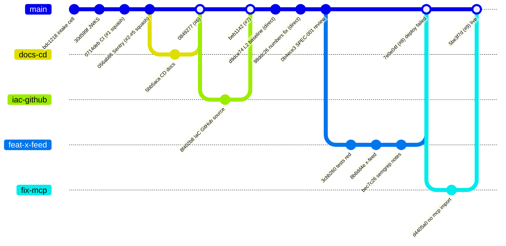
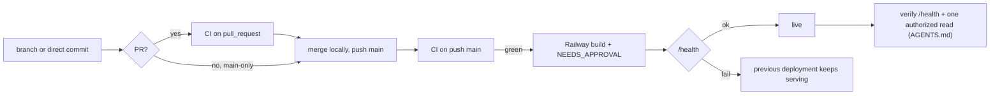

# 18 — Git / release workflow

ไม่มี ruleset หรือ branch protection บน `main` (`gh api repos/bookchaowalit/platform-intake-api/rulesets` = `[]`, `branches/main` `protected: false`). ใช้ทั้ง PR (merge commit หรือ squash) และ direct commit บน `main` (Wave 2, SPEC-001 "Main-only: yes"). ไม่มี tag/release. Deploy = Railway Wait for CI บน `main`.

Sources: `git log origin/main`, `gh pr list -R bookchaowalit/platform-intake-api --state all`, `gh api .../rulesets`, `README.md`, `specs/001-l2-baseline/spec.md`, ops record: x-feed-intake-source (2026-11-03)

Sources: `AGENTS.md`, `.railway/railway.ts`, `.github/workflows/ci.yml`, ops record: railway-deploy-approval-gate (2026-11-03)

## Open questions

- ต้องการ branch protection (required checks) บน `main` หรือไม่.
