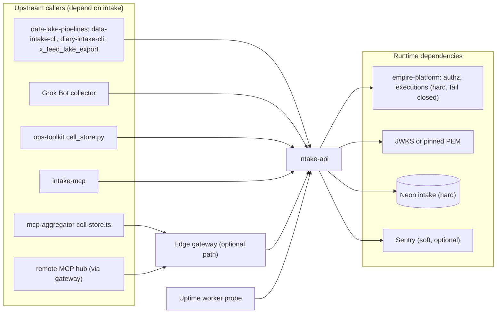

# 19 — Service dependency map

Sources: `PRODUCT.md` (Users), `docs/x-feed-ingest.md`, `src/cellkit/platform.py`, `src/cellkit/auth.py`, `src/cellkit/db.py`, `src/cellkit/_sentry.py`, `src/cellkit/mcp.py`, `pyproject.toml`, ops record: api-gateway-edge (2026-11-03), uptime `src/targets.ts`

| Dependency | Kind | Failure effect (code) |
|---|---|---|
| empire-platform | hard, every request with auth | 503 `authorization_unavailable`; 401 when platform refuses token |
| Neon `intake` | hard | 503 `unavailable` on `OperationalError`; connect timeout 15 s |
| JWKS | soft (cache keeps last good keys; PEM fallback) | 401 if no key |
| Sentry | soft | no-op without DSN |
| Python libs | `fastapi`, `psycopg[binary]`, `pyjwt[crypto]`, `uvicorn[standard]`, `httpx`, `pyyaml`, `sentry-sdk`; `mcp` only for intake-mcp | locked in `uv.lock` |

ตัวอย่างจริง: 2026-10-28 Neon `empire-platform` เกิน quota → grant ของ intake ทำไม่ได้, owner-mcp ได้ 403 จนแก้ 2026-11-03 (ops record: x-feed-intake-source, api-gateway-edge).
