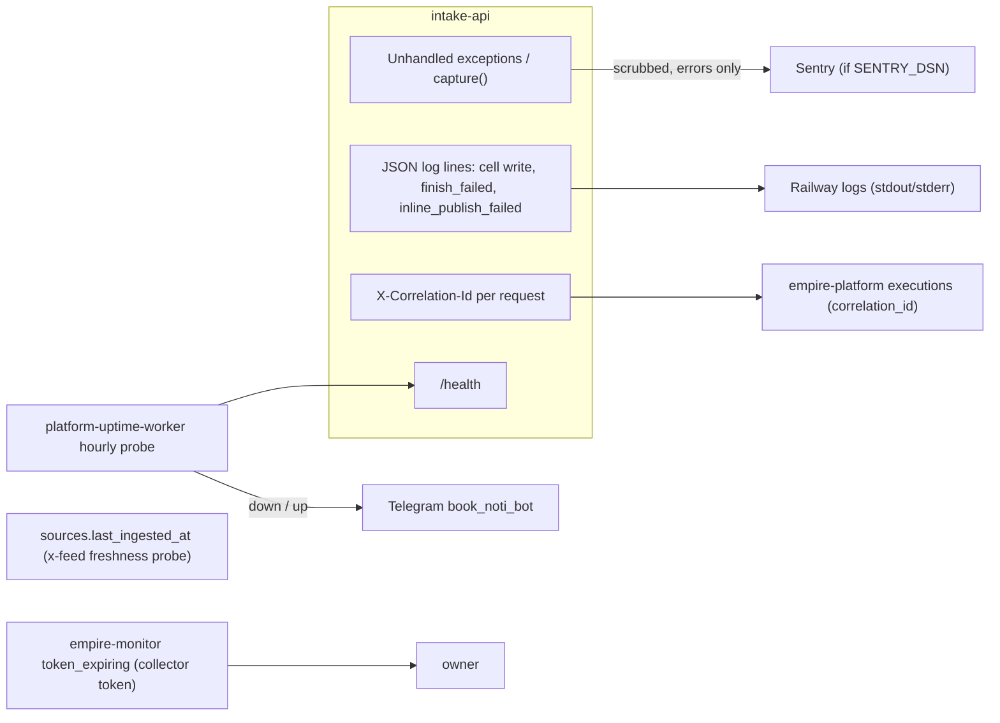

# 20 — Observability

Sources: `src/cellkit/_sentry.py`, `src/cellkit/app.py` (`correlate`, `write`, `publish_soon`), `src/solo_intake/x_feed.py` `source_id`, `docs/x-feed-ingest.md` Token, `PRODUCT.md`, ops record: prod-baseline-monitoring-backups (2026-11-03), uptime `src/targets.ts`

| Signal | What is watched | Where |
|---|---|---|
| Uptime | `GET https://intake-api-production.up.railway.app/health`, hourly (serverless `SLEEPS` set) | uptime `src/targets.ts` |
| Errors | exceptions, failed audit finish, failed inline publish | Sentry, tag `service` = `RAILWAY_SERVICE_NAME`, release = commit SHA |
| Write log | `{"event":"intake.write","action","execution","actor","workspace"}` | Railway logs |
| Audit | every write's execution + before/after hash | empire-platform |
| Freshness | `x-feed` source `last_ingested_at` | `/v1/sources` (no alert wired in this repo) |
| Collector token expiry | `token_expiring` 7 days before | empire-monitor (outside repo) |

- `/health` ไม่ตรวจ DB หรือ platform → uptime เขียวได้แม้ Neon ล่ม.
- ไม่มี metrics endpoint, ไม่มี tracing (ตั้งใจปิด, ADR-0006). `PRODUCT.md` Measures ยังไม่มีตัวเก็บ.

## Open questions

- `SENTRY_DSN` ตั้งใน Railway แล้วจริงหรือไม่ และ alert rule ไปช่องไหน.
- ใครเฝ้า `last_ingested_at` ของ `x-feed` (ไม่มี heartbeat ของ collector).
