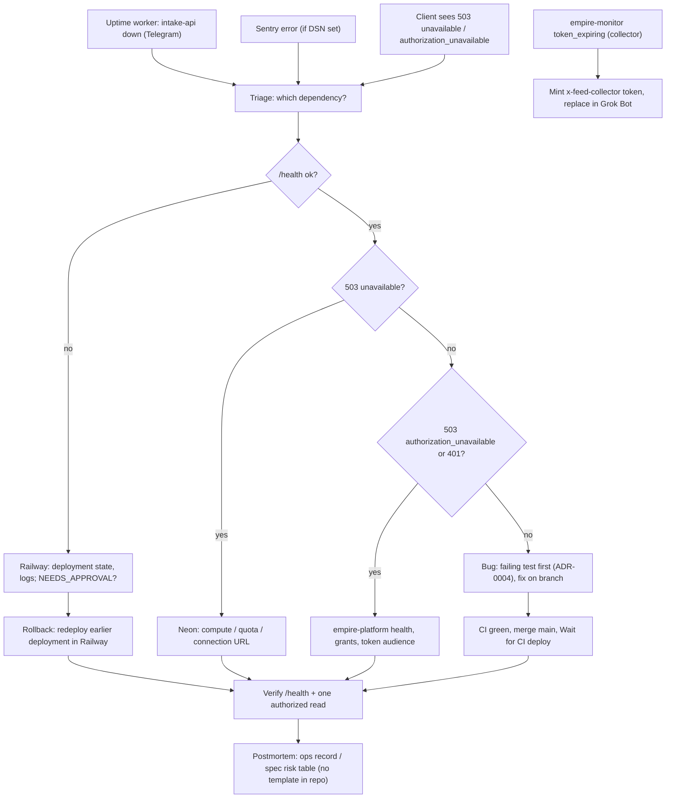

# 21 — Incident response

ไม่มี runbook ใน repo; flow นี้ประกอบจาก alert channel และขั้นตอนที่ `README.md` / `AGENTS.md` / `docs/x-feed-ingest.md` ระบุ.

Sources: `README.md` (rollback), `AGENTS.md` (verify after merge, failing test first), `src/cellkit/app.py` (503/401 codes), `docs/x-feed-ingest.md` (Errors, Token), ops record: prod-baseline-monitoring-backups (2026-11-03), ops record: railway-deploy-approval-gate (2026-11-03)

## เหตุการณ์ที่บันทึกไว้

| Date | What | Resolution | Source |
|---|---|---|---|
| 2026-10-28 | `7e0e04f` (#8) deploy fail healthcheck: `x_feed.py` import `cellkit.mcp`, image ไม่มี `mcp` extra | #9 `5be3f7d` แยก MCP tools ไป `x_feed_mcp.py`; prod อยู่บน deploy เดิมระหว่างนั้น | ops record: x-feed-intake-source; `tests/test_x_feed_mcp.py::test_api_hook_loads_without_the_mcp_extra` |
| 2026-10-28 → 11-03 | owner-mcp ได้ 403 จาก intake: owner role ขาด 12 `intake.x-*` permissions (grant ถูกบล็อกโดย Neon quota ของ empire-platform) | `empire_platform.cells grant --workspace owner --cell intake` 2026-11-03 | ops record: api-gateway-edge |

## Open questions

- Sentry alert rule และช่องทางของ intake-api.
- ต้องการ runbook / postmortem template ใน repo หรือใช้ ops record ต่อ.
