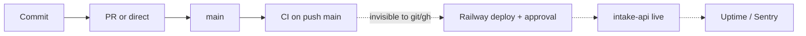

# 22 — DORA metrics

ช่วงวัด: 90 วันถึง 2026-11-04 (ประวัติ repo เริ่ม 2026-10-10 จึงครอบคลุมทั้งหมด). Deploy ทำโดย Railway (GitHub source + Wait for CI) — git/gh **ไม่เห็น deployment** (ไม่มี deploy job, tag หรือ GitHub Deployment). ค่าที่เกี่ยวกับ deploy จึงเป็น proxy หรือมาจาก ops record.



Sources: `.github/workflows/ci.yml`, `.railway/railway.ts`, ops record: railway-deploy-approval-gate (2026-11-03)

| Metric | How measured for this repo | Current value (90 d) | Command |
|---|---|---|---|
| Deployment frequency | ควรนับ Railway deployments ของ `intake-api` | **คำนวณไม่ได้จาก git/gh.** Proxy: 28 first-parent commits บน `main` (4 merge commits, 24 direct/squash), 14 CI push runs บน `main` | `git log --since=90.days --first-parent --oneline origin/main \| wc -l`; `gh run list -R bookchaowalit/platform-intake-api --branch main --event push --limit 100` |
| Lead time for changes | commit author time → merge เข้า main (proxy; ไม่รู้เวลา deploy) | median **162 นาที**, min 1, max 2,768 (8 commits ใน 4 merges); PR open→merge median **5.1 นาที**, max 2,759 นาที (9 merged PRs) | สคริปต์ด้านล่าง; `gh pr list -R bookchaowalit/platform-intake-api --state merged --json createdAt,mergedAt` |
| Change fail rate | deploy ที่ทำให้ prod พัง / deploy ทั้งหมด | **คำนวณไม่ได้** (ไม่รู้จำนวน deploy). ที่รู้: 1 failed deploy (`7e0e04f`, healthcheck) ตาม ops record. Proxy CI: 0 failure จาก 14 runs บน `main` | `gh run list -R bookchaowalit/platform-intake-api --branch main --json conclusion` |
| Failed deployment recovery time | deploy พัง → deploy ที่ใช้ได้ | **~17 นาที** สำหรับเหตุการณ์เดียวที่รู้: merge #8 2026-10-28 04:15:54Z → merge #9 04:32:56Z (Railway คง deploy เดิมไว้ระหว่างนั้น, จึงไม่มี downtime) | `gh pr list ... --json number,mergedAt` |
| Deployment rework rate | deploy ที่แก้ deploy ก่อนหน้า (ไม่ได้วางแผน) | **คำนวณไม่ได้ระดับ deploy.** Proxy: 4 จาก 9 merged PRs เป็น rework ของ PR ก่อนหน้า (#3, #4, #5 แก้ Sentry ของ #2 ภายใน 41 นาที; #9 แก้ #8) | `gh pr list -R bookchaowalit/platform-intake-api --state merged --json number,title,mergedAt` |

สคริปต์ lead time (commit → merge บน main):

```bash
git log --since=90.days --merges --first-parent --format='%H %ct' origin/main |
while read h t; do
  for c in $(git rev-list $h^1..$h^2); do
    echo $(( (t - $(git log -1 --format=%at $c)) / 60 ))
  done
done | sort -n   # n=8, median 162, max 2768 (minutes)
```

หมายเหตุ: commit ที่ squash-merge หรือ push ตรง `main` (24 ตัว) ไม่มี merge commit จึงไม่อยู่ในตัวเลข commit→merge; PR open→merge ครอบคลุม PR ทั้ง 9.

Sources: คำสั่งด้านบนรัน 2026-11-04 บน worktree ที่ `origin/main` = `5be3f7d`; ops record: x-feed-intake-source (2026-11-03)

## จะวัดได้จริงต้องมีอะไร

- ดึง Railway deployments ของ service (`railway deployment list --json` หรือ GraphQL) เป็นแหล่ง deploy event — ได้ deployment frequency, lead time ถึง deploy, change fail rate จริง.
- ผูก uptime down / Sentry issue ใหม่กับ deployment id.

## Open questions

- ยอมให้ใช้ Railway deployment list เป็นแหล่ง DORA หรือไม่?
